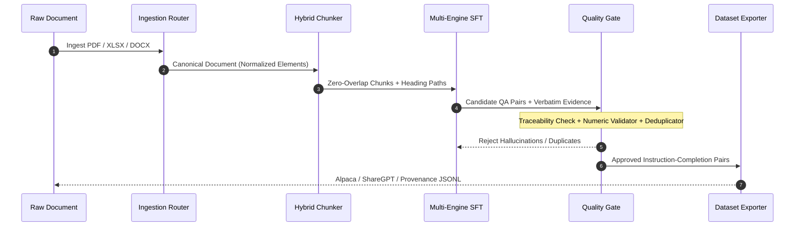

<p align="center">
  <br />
  <a href="https://tiwariar7.github.io/forge-dataset-factory/">
    
  </a>
</p>

<p align="center">
  <a href="https://tiwariar7.github.io/forge-dataset-factory/">
    
  </a>
</p>

<p align="center">
  <a href="https://pypi.org/project/forge-dataset-factory/"></a>
  <a href="https://tiwariar7.github.io/forge-dataset-factory/"></a>
  <a href="https://github.com/tiwariar7/forge-dataset-factory/actions"></a>
  <a href="#"></a>
  <a href="LICENSE"></a>
</p>

<p align="center">
  <a href="https://tiwariar7.github.io/forge-dataset-factory/"><b>Documentation</b></a> |
  <a href="#quickstart"><b>Quickstart</b></a> |
  <a href="#supported-inference-engines"><b>Inference Engines</b></a> |
  <a href="#command-line-interface"><b>CLI</b></a> |
  <a href="#pipeline-architecture"><b>Architecture</b></a> |
  <a href="https://github.com/tiwariar7/forge-dataset-factory"><b>GitHub</b></a>
</p>

---

### Documentation Portal
Comprehensive guides, API specifications, and cookbook recipes are hosted at:  
**https://tiwariar7.github.io/forge-dataset-factory/**

---

**ForgeDataset** is an industrial-strength Python library designed to transform uncurated business and technical documents (PDF, DOCX, XLSX, PPTX, Markdown, CSV, Code) into production-grade Supervised Fine-Tuning (SFT) datasets with **zero cloud reliance**, **pluggable local LLM backends**, and **non-negotiable character-level evidence grounding**.

<p align="center">
  
</p>

---

## Core Differentiators

```
[ Intelligent Routing ]              [ Hybrid Zero-Overlap ]             [ Multi-Engine Inference ]
  Auto-selects Docling,                Eliminates repetitive               Direct GGUF (llama.cpp),
  OpenPyXL, or native parsers   -->    sliding-window token bleed   -->    Ollama, or vLLM backends
                                                                                     |
                                                                                     v
[ Training-Ready Export ]            [ Semantic Deduplication ]          [ Strict Verbatim Quality Gate ]
  Document-level split Alpaca,         Cosine similarity filter            Purges ungrounded answers &
  ShareGPT, & Audit JSONL       <--    prunes redundant queries     <--    hallucinated numbers
```

1. **Pluggable Local Engines**: Run local `.gguf` weights directly in Python with **`llama.cpp`** (zero daemon required), local **`Ollama`** with automatic VRAM purging, or high-throughput batching via **`vLLM`** (`/v1`).
2. **Strict Verbatim Evidence Provenance**: Non-negotiable rule: every generated completion must quote exact verbatim substring spans from the parent document chunk.
3. **Symbolic Numeric Validator**: Automatically scans every number, percentage, and metric in the generated answer to verify existence in the source text, preventing hallucinated calculations.
4. **Zero-Overlap Hybrid Chunking**: Respects document structural hierarchies (`heading_path`) and duplicates table headers across chunk splits without sliding-window token pollution.
5. **No Database Dependencies**: Operates purely in-memory (`:memory:`) or exports directly to training-ready JSONL/Parquet files without disk locking.

---

## Installation

```bash
# Core library
pip install forge-dataset-factory

# With in-process GGUF llama.cpp support
pip install "forge-dataset-factory[llamacpp]"

# With local FastAPI server and developer tools
pip install "forge-dataset-factory[all]"
```

<details>
<summary><b>Installing from source (Editable mode)</b></summary>

```bash
git clone https://github.com/tiwariar7/forge-dataset-factory.git
cd forge-dataset-factory
pip install -e ".[all]"
```
</details>

---

## Quickstart

Generate a verified SFT fine-tuning dataset in Python:

```python
from ForgeDataset import (
    IngestionRouter,
    HybridChunker,
    SFTGenerator,
    QualityGate,
    DatasetExporter,
)

# 1. Ingest document (auto-routed to Docling / OpenPyXL / Native extractors)
router = IngestionRouter()
doc = router.route("quarterly_earnings.pdf")

# 2. Structural chunking (zero token overlap, heading-aware)
chunker = HybridChunker(max_source_context=600, overlap=0)
chunks = chunker.chunk_document(doc)

# 3. Candidate SFT generation with verbatim evidence citations
# Supported engines: "llama_cpp", "ollama", "openai", "heuristic"
generator = SFTGenerator(engine="ollama", model="qwen2.5:7b-instruct")

# 4. Strict Quality Gate and numerical validation
gate = QualityGate()
verified_pairs = []

for chunk in chunks:
    candidates = generator.generate_from_chunk(chunk)
    for candidate in candidates:
        evaluated = gate.evaluate(candidate, chunk)
        if evaluated.status == "approved":
            verified_pairs.append((evaluated, chunk))

# 5. Export training splits (Alpaca or ShareGPT format)
exporter = DatasetExporter(output_dir="output")
results = exporter.export(verified_pairs, format_type="alpaca", prefix="finance_sft")

print(f"Generated {results['approved_count']} approved SFT examples.")
```

---

## Supported Inference Engines

| Engine Backend | Class | Execution Mode | Recommended Use Case |
| :--- | :--- | :--- | :--- |
| **`llama_cpp`** | `LlamaCppEngine` | **In-process GGUF** | Zero server setup, single GPU (CUDA), Apple Silicon (Metal), or CPU |
| **`ollama`** | `OllamaEngine` | **HTTP REST Daemon** | Existing local Ollama installations with sequential VRAM management |
| **`openai`** | `OpenAICompatibleEngine` | **`/v1` HTTP API** | High-throughput production batching with **vLLM**, LM Studio, or LocalAI |
| **`heuristic`** | `HeuristicEngine` | **Deterministic Regex** | Fast offline CI/CD test runs with zero GPU dependencies |

<details>
<summary><b>Example: In-process GGUF with llama.cpp</b></summary>

```python
from ForgeDataset import SFTGenerator
from ForgeDataset.engines import LlamaCppEngine

# Point directly to your downloaded .gguf file (no daemon needed)
engine = LlamaCppEngine(
    model_path="models/qwen2.5-7b-instruct.Q4_K_M.gguf",
    n_ctx=4096,
    n_gpu_layers=-1  # Offload all layers to GPU
)

generator = SFTGenerator(engine=engine)
pairs = generator.generate_from_chunk(chunk)
```
</details>

<details>
<summary><b>Example: High-throughput batching with vLLM</b></summary>

```python
from ForgeDataset import SFTGenerator
from ForgeDataset.engines import OpenAICompatibleEngine

# Connect to a high-concurrency local vLLM instance
engine = OpenAICompatibleEngine(
    model="Qwen/Qwen2.5-7B-Instruct",
    base_url="http://localhost:8000/v1"
)

generator = SFTGenerator(engine=engine)
pairs = generator.generate_from_chunk(chunk)
```
</details>

---

## Command-Line Interface

ForgeDataset includes a command-line interface for terminal automation:

```bash
# 1. Process a document directly into an Alpaca-format SFT dataset
forge-dataset process annual_report.pdf --engine ollama --model qwen2.5:7b-instruct -o output/dataset.jsonl

# 2. Run GGUF inference in-process
forge-dataset process technical_manual.docx --engine llama_cpp --model models/qwen2.5-7b.gguf

# 3. Check engine availability
forge-dataset engines

# 4. Launch optional local REST API server
forge-dataset server --port 8000
```

---

## Pipeline Architecture



---

## Testing and Verification

ForgeDataset includes 36 automated unit and integration tests:

```bash
# Run full pytest suite
pytest -v

# Run end-to-end smoke test
python tests/smoke_test_e2e.py
```

---

## Documentation Links

- **Documentation Portal**: https://tiwariar7.github.io/forge-dataset-factory/
- **Architecture Specification**: [docs/ARCHITECTURE.md](docs/ARCHITECTURE.md)
- **Inference Engines Guide**: [docs/ENGINES.md](docs/ENGINES.md)
- **API Reference**: [docs/API_REFERENCE.md](docs/API_REFERENCE.md)

---

## License

Distributed under the **MIT License**. See [LICENSE](LICENSE) for more information.

<p align="center">
  
</p>
