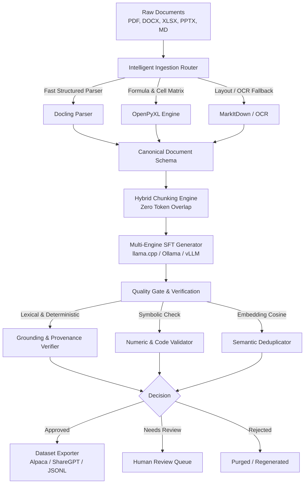

# ForgeDataset Architecture

ForgeDataset is designed as a **100% local, hybrid document-to-SFT dataset factory**. It turns complex, messy business and technical documents into production-grade Supervised Fine-Tuning (SFT) training datasets.

  

---

## The 6-Stage Pipeline

### 1. Intelligent Ingestion Router (`ForgeDataset.ingestion`)
- Inspects file extensions and document structure to route each document to its optimal parser.
- **Excel/Spreadsheets**: Routed through `OpenPyXL` to extract formulas, sheet matrices, and cell bounds.
- **PDFs and Office Docs**: Routed through `Docling` or native parsers.
- **Scanned Documents**: Fallback to OCR layout parser.
- **Normalizes** all documents into a unified `CanonicalDocument` schema with element IDs, bounding boxes, and heading hierarchies.

### 2. Hybrid Chunking Engine (`ForgeDataset.chunking`)
- Preserves document hierarchy by tracking `heading_path` (e.g. `['Database', 'PostgreSQL', 'MVCC']`).
- **Zero-Overlap Guarantee**: Eliminates token bleed between training examples.
- **Table Awareness**: Preserves Markdown/CSV tables with repeated table headers across table chunk splits.
- **Code & Slide Awareness**: Keeps code blocks and presentation slides intact.

### 3. Multi-Engine SFT Generator (`ForgeDataset.generation` & `ForgeDataset.engines`)
- Supports **pluggable local backends**:
  - `llama-cpp-python` for in-process GGUF model execution (no background server needed).
  - `Ollama` for local daemon execution with VRAM purging (`keep_alive: 0`).
  - `OpenAI-compatible` for `vLLM` high-throughput local servers or LM Studio.
  - `Heuristic` for rapid zero-dependency CI/CD testing.
- Generates categorized instruction-completion pairs:
  - *Conceptual*
  - *Definition*
  - *Application*
  - *Analytical*
- Enforces strict verbatim evidence extraction: every generated completion must quote exact source phrases from the chunk.

### 4. Verification & Quality Gate (`ForgeDataset.evaluation`)
- **Non-Negotiable Evidence Rule**: Candidate pairs without exact character-level verbatim matches in the source chunk are instantly rejected.
- **Numeric & Symbolic Validator**: Checks all numbers, percentages, and units in the answer against the cited source chunk to prevent hallucinated numbers.
- **Semantic Deduplication**: Uses `sentence-transformers` embeddings (`all-MiniLM-L6-v2`) with cosine similarity thresholding (default `0.88`) to prune near-duplicate questions.

### 5. Review & Storage Layer (`ForgeDataset.storage`)
- Optional SQLite persistence (`DatabaseManager`).
- Defaults to `:memory:` for clean library usage.
- Allows persistent audit trails for enterprise compliance.

### 6. Dataset Exporter (`ForgeDataset.export`)
- Splits at the **document level** to prevent test set data leakage.
- Formats:
  - **Alpaca** (`instruction`, `input`, `output`)
  - **ShareGPT** (`conversations`: `from`, `value`)
  - **Audit Provenance JSONL** with source elements, character spans, and verification scores.

