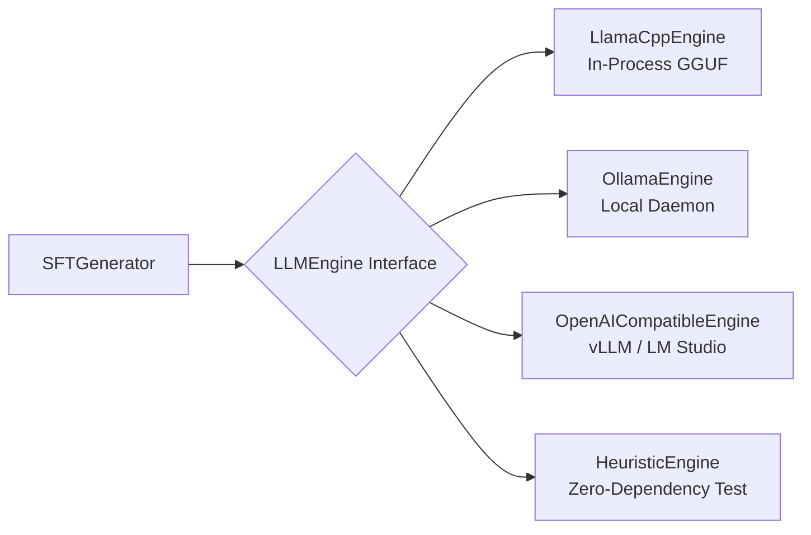

# LLM Inference Engines in ForgeDataset

ForgeDataset does not lock you into a single LLM runner. You can use whatever local or self-hosted inference engine suits your hardware and infrastructure.



---

## 1. llama.cpp (`llama-cpp-python`)
**Best for:** Zero-server, direct in-process GGUF model execution. Ideal for local workstations, laptops (Apple Silicon Metal), and single GPU setups.

### Installation
```bash
# CPU only
pip install llama-cpp-python

# NVIDIA GPU (CUDA)
pip install llama-cpp-python --extra-index-url https://abetlen.github.io/llama-cpp-python/whl/cu121

# Apple Silicon (Metal)
CMAKE_ARGS="-DLLAMA_METAL=on" pip install llama-cpp-python
```

### Python Usage
```python
from ForgeDataset import SFTGenerator
from ForgeDataset.engines import LlamaCppEngine

# Point directly to your local .gguf file
engine = LlamaCppEngine(
    model_path="models/qwen2.5-7b-instruct-q4_k_m.gguf",
    n_ctx=4096,
    n_gpu_layers=-1  # Offload all layers to GPU
)

generator = SFTGenerator(engine=engine)
pairs = generator.generate_from_chunk(chunk)
```

---

## 2. Ollama (`OllamaEngine`)
**Best for:** Developers already running the Ollama desktop or CLI daemon.

### Setup
1. Download Ollama from [ollama.com](https://ollama.com)
2. Pull your model:
   ```bash
   ollama pull qwen2.5:7b-instruct
   ```

### Python Usage
```python
from ForgeDataset import SFTGenerator

# Uses default Ollama instance at http://127.0.0.1:11434
generator = SFTGenerator(
    engine="ollama",
    model="qwen2.5:7b-instruct",
    base_url="http://127.0.0.1:11434"
)
pairs = generator.generate_from_chunk(chunk)
```

---

## 3. OpenAI-Compatible Engines (`vLLM`, `LM Studio`, `LocalAI`)
**Best for:** High-throughput batch production inference (vLLM) or graphical local setups (LM Studio).

### Starting vLLM
```bash
vllm serve Qwen/Qwen2.5-7B-Instruct --port 8000
```

### Python Usage
```python
from ForgeDataset import SFTGenerator
from ForgeDataset.engines import OpenAICompatibleEngine

# Connect to vLLM, LM Studio, or any /v1 endpoint
engine = OpenAICompatibleEngine(
    model="Qwen/Qwen2.5-7B-Instruct",
    base_url="http://localhost:8000/v1"
)

generator = SFTGenerator(engine=engine)
pairs = generator.generate_from_chunk(chunk)
```

---

## 4. Zero-Dependency Heuristic Engine (`HeuristicEngine`)
**Best for:** Unit testing, CI/CD pipelines, and air-gapped systems without GPU/LLM infrastructure.

```python
from ForgeDataset import SFTGenerator

generator = SFTGenerator(engine="heuristic")
pairs = generator.generate_from_chunk(chunk)
```

---

## 5. Custom Engines
You can implement your own backend by subclassing `LLMEngine`:

```python
from ForgeDataset.engines import LLMEngine
from typing import Dict, Any, Optional

class MyCustomEngine(LLMEngine):
    def is_available(self) -> bool:
        return True

    def generate(
        self,
        prompt: str,
        system: Optional[str] = None,
        json_format: bool = True,
        temperature: float = 0.3,
        **kwargs: Any
    ) -> Dict[str, Any]:
        # Your custom model call here
        return {"qa_pairs": [{"question": "...", "answer": "...", "evidence": "..."}]}

generator = SFTGenerator(engine=MyCustomEngine())
```
